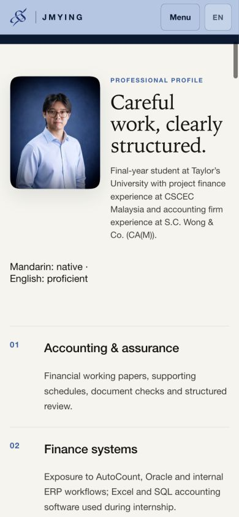
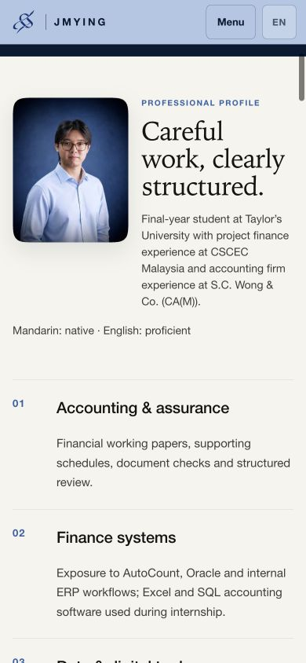
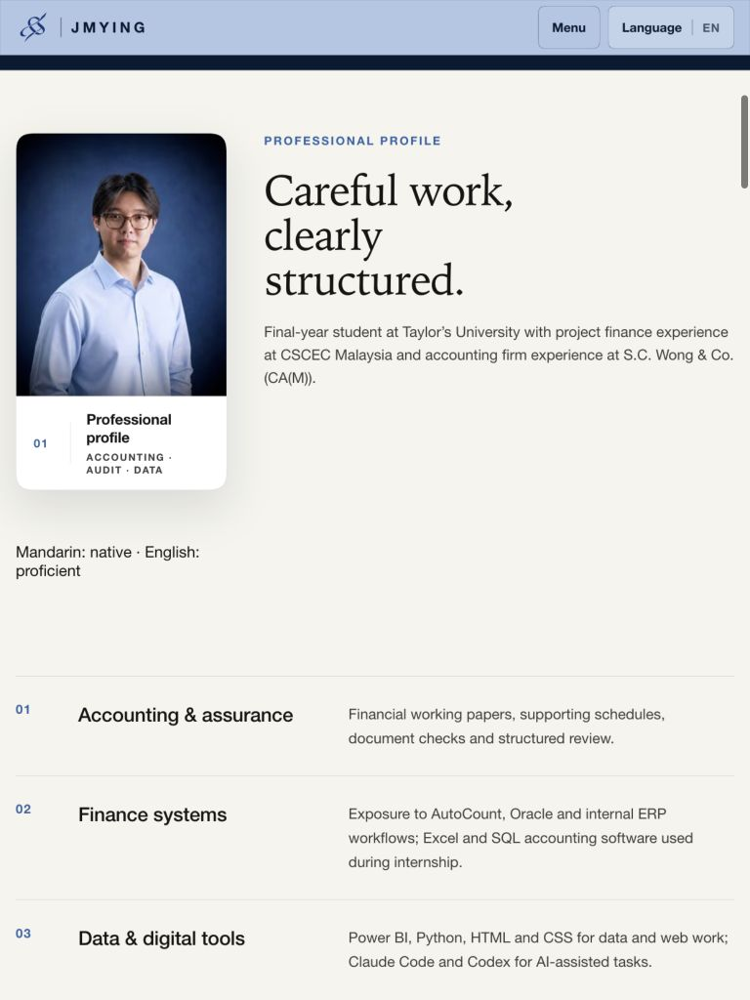
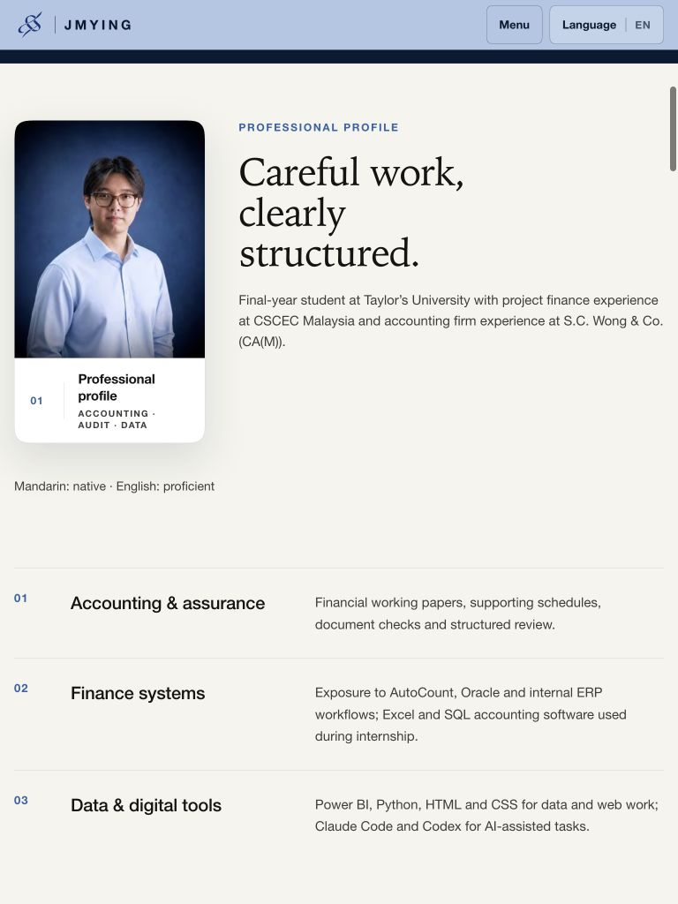

# 跨尺寸视觉检查与修复 · 1.17.1

本轮直接查看了新捕获的浏览器截图，再修复发现的问题；没有把“测试通过”当成视觉正常的替代证据。保留原有照片、暖白与蓝色、克制动效和研究交互。

## 检查范围

- 1440×1000 桌面、1024×768 / 768×1024 平板、390×844 手机、320×740 窄屏、844×390 横屏弹窗。
- 实际截图检查英文、简体中文、德文与阿拉伯语，以及浅色、深色、强制颜色和减少动态效果状态。
- 补充 Chromium / WebKit 浏览器模拟检查，包含关闭脚本后的页面行为。89 项浏览器测试和完整源文件检查通过；14 种语言切换与 125 个翻译键保持完整。
- 这是浏览器与尺寸模拟检查，并非 Windows、Android、iPhone 等全部真机认证；截图也不能单独证明完整无障碍合规。

## 逐步结果

| 步骤 | 查看内容                                | 结果                                                     |
| ---- | --------------------------------------- | -------------------------------------------------------- |
| 1    | 首屏、导航、手机菜单与返回顶部          | 已修复 Logo / 页尾链接无法返回首屏；标题、照片和菜单正常 |
| 2    | 简介、语言能力栏、窄屏德文与 RTL        | 已修复窄栏碎行和长复合词断行；照片比例及左右阅读关系正常 |
| 3    | 经历、教育与证据时间轴                  | 层次和换行正常；表内横向浏览保留在自身区域               |
| 4    | Independent research / Research process | 代码输入、六步选择、焦点和内容区正常                     |
| 5    | 工作方法与工具列表                      | 手机标题、编号和说明对齐正常                             |
| 6    | 项目卡片、详情弹窗与 AI 研究媒体        | 相邻卡片提示、关闭按钮、静态媒体和文字正常               |
| 7    | 证书、联系、页尾及语言弹窗              | 列表和联系按钮正常；横屏弹窗仍能关闭和滚动               |

## 发现与修复

1. **P1 · 返回首屏失败。** `#top` 位于固定停留在视口顶部的导航栏，点击后仍停在文档中段。已把目标移至文档起点；导航 Logo 和页尾链接在两种内核、有脚本 / 无脚本、手机 / 桌面下均验证返回 0。
2. **P2 · 简介的语言能力被挤在照片下方。** 390px 英文被挤成两行，中文把“英语”拆开，768px 平板也有狭窄换行和多余留白。已让补充语言信息跨越完整网格行，调整字号与段落间距。
3. **P2 · 德文复合词被硬截断。** 320px 下 `Projektfinanzbuchhaltung` 的末尾只剩两个字母单独成行。已在词义边界加入可选断点。跨浏览器复查后保留英文自然换行，避免把 Malaysia 等地名拆开。

手机简介，390×844，修复前 / 后：

德文简介，320×740，修复前 / 后：

平板简介，768×1024，修复前 / 后：

## 证据与边界

正式站基线使用内置浏览器捕获；其无法连接本机预览后，改用独立 Chrome 预览窗口复核修复，并补充 WebKit 截图。以上对照保持相同尺寸、语言和页面位置；完整现场截图保存在本地 `qa/visual-audit/`，包括首屏、菜单、项目详情、联系、深色 / 强制颜色和横屏弹窗。

冷配置性能与无障碍评分：手机 100/100（LCP 1.6s、TBT 10ms、CLS 0）；桌面 100/100（LCP 0.5s、TBT 0ms、CLS 0）。这些是本地实验室测量，不等于所有真实网络条件下的表现。现有资源体积上限、内容、照片、交互和隐私约束保持原样。

最终结果：本轮发现的 P1 / P2 问题已关闭。
